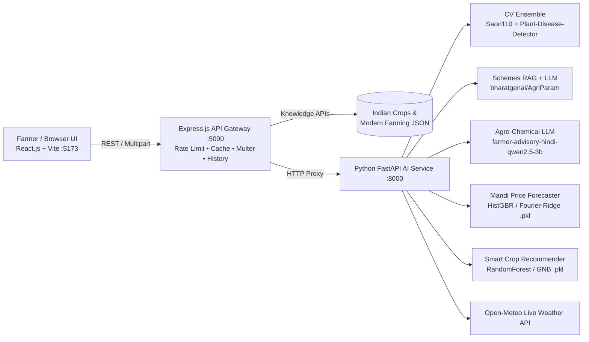

# KrishiAI — High-Level Design (HLD)

## 1. Architectural Vision
KrishiAI follows a **3-Tier Decoupled Microservices Architecture** separating presentation, API gateway/orchestration, and compute-intensive AI/ML/DL inference so each tier scales independently at zero cloud licensing cost.

## 2. Service Responsibilities
1. **Frontend (React.js + Vite, Port 5173)**
   - Single-page responsive agri-tech dashboard supporting desktop & mobile browsers.
   - Handles image upload previews, GPS geolocation, bilingual Hindi/English chat, Recharts time-series visualization, and structured loading/error states.
2. **API Gateway & Orchestrator (Express.js, Port 5000)**
   - Security headers (`helmet`), CORS, request ID tracing (`X-Request-Id`), sliding-window rate limiting (`120 req/min`), and Multer image MIME/size validation (`<=10 MB`).
   - TTL in-memory caching for high-read endpoints (weather forecasts, mandi metadata).
   - Serves curated Indian Crops Encyclopedia and Modern Farming Knowledge Hub directly with sub-5ms latency.
   - Persists recent farmer activity history (`activityHistory.json`) for dashboard auditing.
3. **AI / ML / DL Microservice (Python FastAPI, Port 8000)**
   - Runs all deep learning vision models, domain LLMs, and tabular/time-series ML models via a singleton `ModelRegistry`.
   - 3-Tier Graceful Degradation (`Local PyTorch` → `Free HF Inference API` → `Grounded OpenCV/RAG/Local ML`) guarantees zero crashes on resource-constrained hardware.

## 3. Scalability & Production Evolution Path
- **Horizontal Scaling**: Express gateway and FastAPI stateless workers can be scaled behind Nginx/Traefik.
- **GPU Worker Separation**: Heavy LLM workers (`AgriParam`, `Qwen2.5-3B`) can be isolated onto a dedicated vLLM/SGLang GPU node without changing Express or React contracts.
- **Database Upgrade**: File-backed `activityHistory.json` can be swapped for PostgreSQL/MongoDB inside `backend/src/services/historyStore.js` with zero controller changes.
